<p align="center"></p>

# SyncMe for Android

SyncMe is an open-source Android messenger for private, secure and decentralized communication, built as an independent fork of [Element X Android](https://github.com/element-hq/element-x-android) on the [Matrix](https://matrix.org/) open protocol. Matrix lets people choose a messaging server they trust or run their own, while independently operated servers can communicate without relying on any single company or government to operate the network. Building on Element X’s account, synchronization and end-to-end encryption foundations, SyncMe aims to make decentralized messaging feel as smooth and accessible as mainstream chat apps, with online and Away presence, last-seen indicators, personal conversation tags, improved read receipts and “Seen by” details, message reactions, richer media albums, real-time upload progress and cancellation, refined chat layouts, and better right-to-left support. The project is built primarily with Kotlin, Jetpack Compose, Appyx and the Matrix Rust SDK, and its SyncMe-specific modifications are released under the AGPL-3.0-or-later license.

The goal is to make secure messaging easy for anyone, with the responsiveness, simplicity and visual appeal people expect from a modern chat app. [DrEsmaily](https://github.com/DrEsmaily) maintains the Android fork. The upstream client provides accounts, sync and end-to-end encryption in encrypted rooms. SyncMe’s work ranges from the layout of a photo album to how the app recovers when an update download loses its connection.

**[Download the ARM64 APK](https://github.com/DrEsmaily/Syncme/releases/download/v1.5.3-build285/SyncMe-285-ARM64.apk)** · [Browse the released source](https://github.com/DrEsmaily/Syncme/tree/v1.5.3-build285) · [Build and test run](https://github.com/DrEsmaily/Syncme/actions/runs/43751178979)
Version 1.5.3 · Build 285 · Android 7.0 or later

**Explore the project** · [Screenshots](#screenshots) · [Engineering decisions and tests](#engineering-decisions-in-the-released-code) · [Build from source](#build-and-release) · [Branch guide](docs/syncme/branches.md)

Two investigations illustrate the work behind the interface. A successful identity reset could leave the user waiting indefinitely because the screen was watching the state of key backup, a separate operation. In the chat timeline, a read receipt could advance beyond the last message the user had actually seen. The write-ups trace each symptom to its cause and link to the changes that followed. [Identity recovery](#encryption-recovery-and-diagnostics) · [Read receipts](#presence-unread-state-and-read-receipts)

## Why this project matters

Freedom of expression has a practical dimension for a community: its members can help decide who moderates their conversations and which rules apply. Access to the client’s source code gives them another way to participate. They can inspect how messages and updates are handled, adapt the app to local needs and share their changes under the [AGPL license](LICENSE).

## Engineering history: from the first Android builds to independent releases

The early Android builds exposed problems at the boundaries between the app, the Matrix Rust SDK and the network. An upload could appear to restart, an identity reset could succeed while the screen kept spinning, and a background chat could acknowledge a message the user had never seen. The changes below explain how those symptoms were investigated and what shipped.

### Media uploads and opening a conversation

A comparison with the Google Play client initially suggested a roughly tenfold upload slowdown. The two apps were taking different VPN routes. Testing the upstream build with the VPN disabled isolated the routing difference. A separate symptom remained: some large transfers stalled or repeated progress. SyncMe restored the SDK send queue as the transfer path, removed duplicate progress collectors and guarded against starting a second job for the same upload action. Cancellation targets the queued send. The large-file stall remained an item for controlled device testing. [Original investigation and device observations][early-notes]

The progress UI then had to represent what that queue actually knew. It displays transferred bytes and percentage from the SDK. A video bubble that expanded to nearly the width of the screen during upload was traced to a full-width layout flag. The revised layout measures the media first and widens the bubble only as far as its status line requires. On the navigation side, a room lookup with a wait of up to 50 ms was taken out of the tap-to-open path. The conversation screen can open while its room data loads. [Implementation history][lineage]

### Startup, certificate verification and push registration

The startup investigation traced a possible network wait into the Android certificate verifier called by Rust through JNI. A certificate revocation lookup could contact an external service synchronously during a TLS handshake. SyncMe brought the verifier into the source tree, preserved its JNI contract and restored standard OkHttp authentication. Android still checks system trust, certificate validity and permitted key usage, and Rust verifies the hostname. The tradeoff is explicit: the verifier skips online OCSP/CRL checks, so it cannot detect revocation through those services. Regression cases cover malformed, expired and untrusted chains as well as trust-provider errors. [Root-cause analysis and verification policy][root-cause]

Firebase registration had a different failure mode. A blank cached token could bypass the wait for a usable one, and a token stream that ended early could throw. The registration path now rejects blank values, bounds the wait, returns an explicit failure when the stream ends and preserves cancellation. The investigation distinguishes these client fixes from end-to-end notification delivery, which also depends on the device and push service. [Push investigation and test cases][root-cause]

### Encryption recovery and diagnostics

A successful identity reset could leave the password screen spinning indefinitely because the UI was waiting for key backup to become enabled. Those are independent operations. SyncMe now completes the reset on SDK success across password, OAuth and no-auth flows, handles duplicate submissions and cancels superseded observers. A user who has disabled backup can finish a reset while keeping that choice. [Reset lifecycle and regression cases][root-cause]

For intermittent “unable to decrypt” reports, SyncMe added opt-in diagnostics that let a developer correlate sender and receiver events. Reports record timing, lifecycle transitions and fingerprinted identifiers. A bounded queue and two 256 KB files limit storage, and exports exclude message content, credentials and encryption keys. This gives investigators a way to distinguish local send admission from evidence that a receiving device actually obtained a key. [Diagnostics design and limits][presence-review]

### Presence, unread state and read receipts

The pinned SDK did not expose incoming presence. An early implementation opened a second Matrix sync stream, which could acknowledge encryption events before the primary SDK consumed them. The replacement reads authenticated presence snapshots for visible users and leaves sync ownership with the SDK. Workers share rate-limit cooldowns, release subscriptions as screens close and refresh on reconnection. A later investigation also caught a gap between the test fake and the production client: the real SDK presence publisher was missing. Wiring it explicitly and adding recovery after failed publication addressed that separate problem. [Presence investigation, builds 246–252][presence-review]

The receipt work followed a message from its local echo through server event-ID resolution, viewport layout and acknowledgement. Automatic receipts now require a resumed conversation and target the event the user actually saw. A failed request stays eligible for retry, and a delayed acknowledgement cannot move the read position backwards. Incoming replies, deleted messages, pagination and thread boundaries are accounted for when placing reader avatars. The timeline also remembers whether the user was following new messages before a burst arrived, so someone reading history can stay in place. [Timeline and receipt investigations, builds 247–251][presence-review]

### Release verification and self-hosted distribution

One early workflow labelled its run Build 244 while the APK and manifest identified Build 243. That discrepancy is preserved in the archive. The release process now verifies the packaged APK’s identity, version, ABI and native verifier class, and records its source commit, CI run and SHA-256 digest. The release includes a matching update manifest for self-hosting. Each published APK can be traced to a source commit and a build run with its verification results. [Original build record][root-cause] · [Build 285 workflow][build-workflow] · [Update hosting guide][hosting]

[early-notes]: https://github.com/DrEsmaily/Syncme/blob/v1.5.3-build285/.github/SYNCME_CONTINUATION_MASTER.txt
[lineage]: https://github.com/DrEsmaily/Syncme/blob/v1.5.3-build285/docs/syncme/history/current-lineage.md
[root-cause]: https://github.com/DrEsmaily/Syncme/blob/v1.5.3-build285/docs/syncme/root-cause-review.md
[presence-review]: https://github.com/DrEsmaily/Syncme/blob/v1.5.3-build285/docs/syncme/presence-review.md
[build-workflow]: https://github.com/DrEsmaily/Syncme/blob/v1.5.3-build285/.github/workflows/syncme-bubble-colors-review.yml
[hosting]: https://github.com/DrEsmaily/Syncme/blob/v1.5.3-build285/docs/syncme/update-hosting.md

## Screenshots

<table>
<tr>
    <td align="center" width="33%">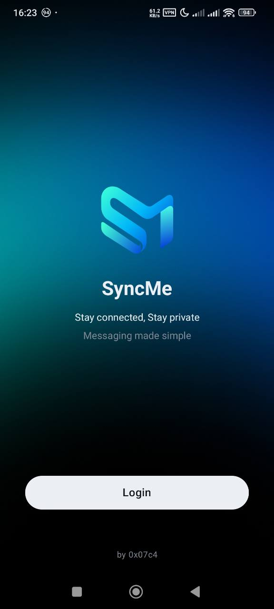<br /><sub>Welcome</sub></td>
    <td align="center" width="33%">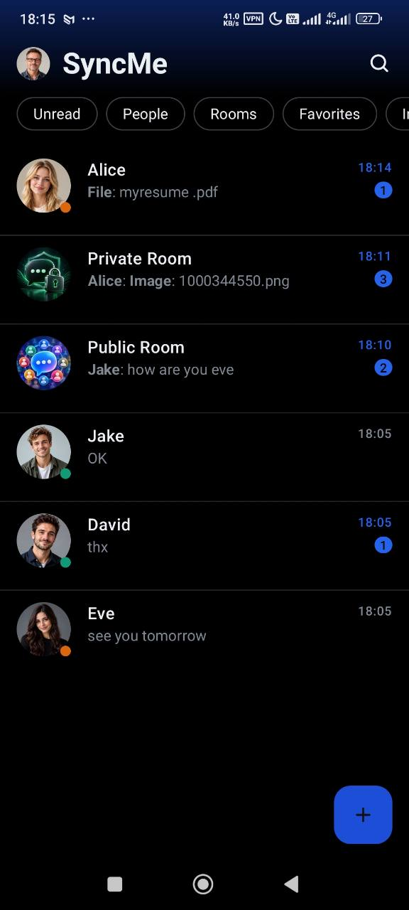<br /><sub>Online and Away presence</sub></td>
    <td align="center" width="33%">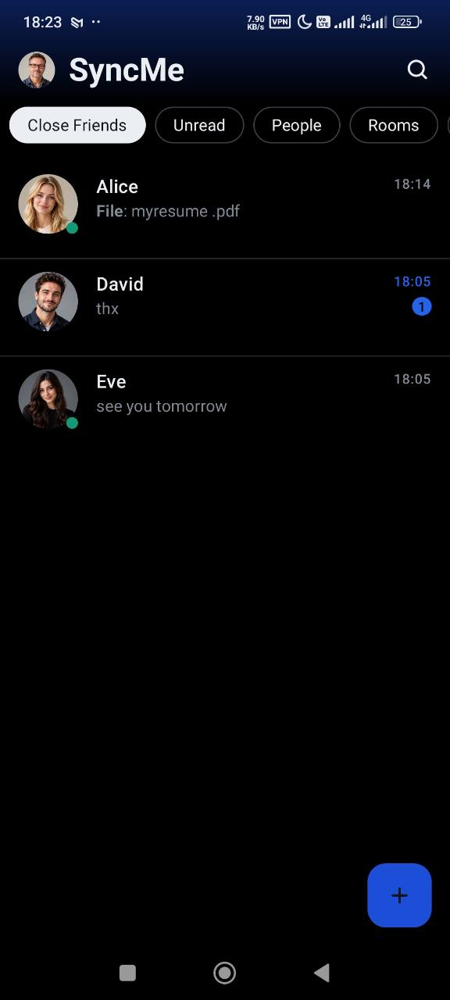<br /><sub>Personal tag filter</sub></td>
  </tr>
<tr>
    <td align="center" width="33%">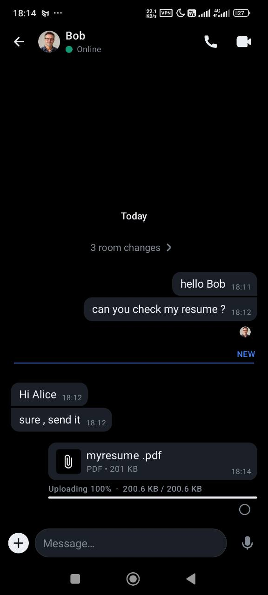<br /><sub>Upload percentage and size</sub></td>
    <td align="center" width="33%">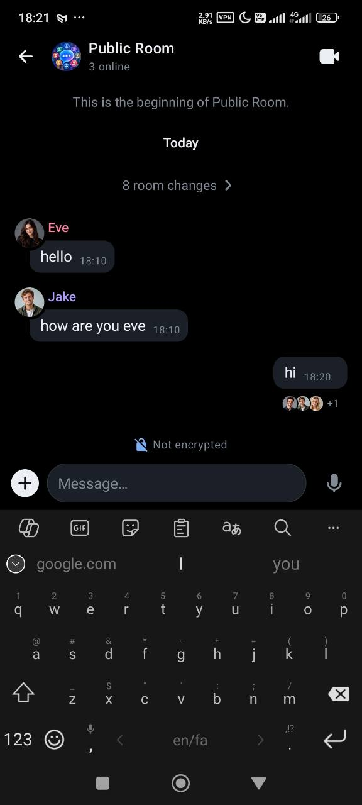<br /><sub>Group presence and reader avatars</sub></td>
    <td align="center" width="33%">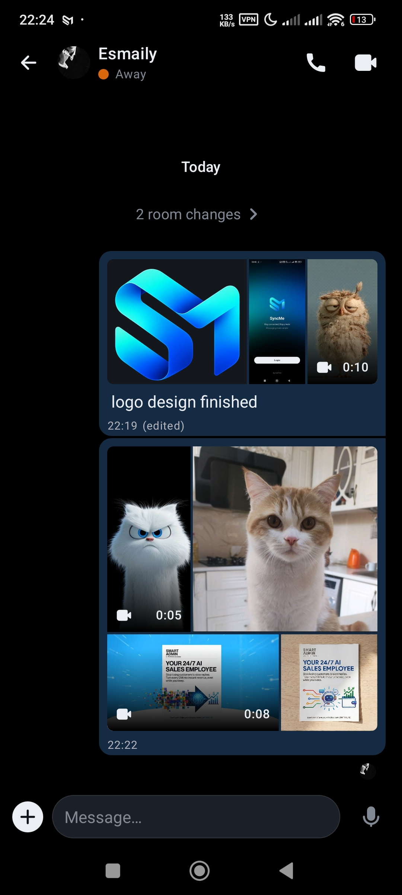<br /><sub>Away presence and media album</sub></td>
  </tr>
<tr>
    <td align="center" width="33%">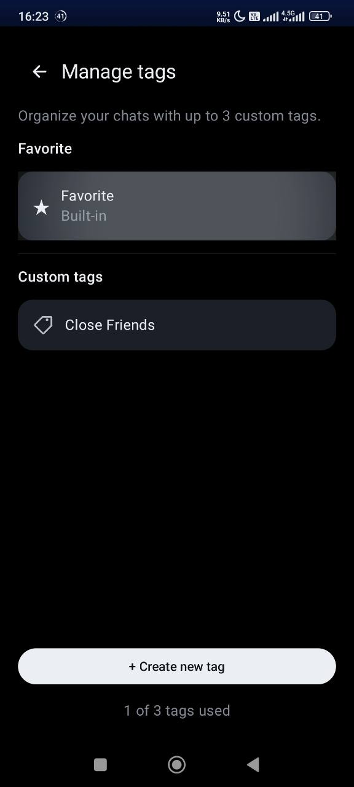<br /><sub>Manage personal tags</sub></td>
    <td align="center" width="33%">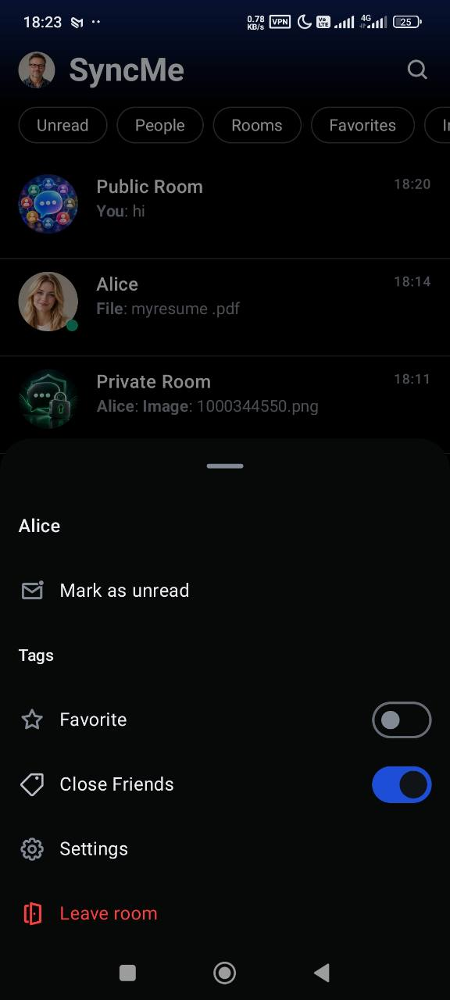<br /><sub>Conversation actions</sub></td>
    <td align="center" width="33%">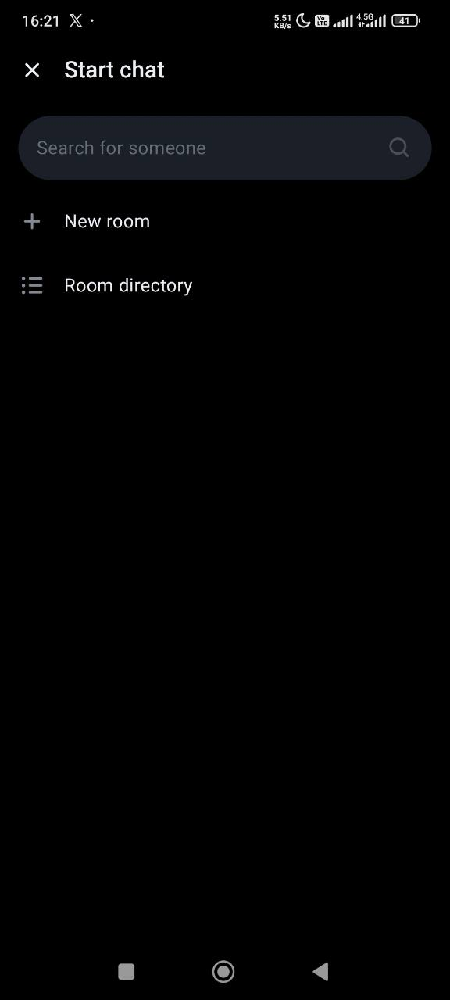<br /><sub>Start a chat</sub></td>
  </tr>
<tr>
    <td align="center" width="33%">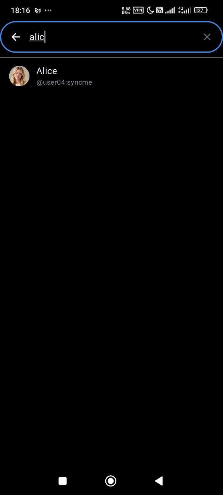<br /><sub>Search for people</sub></td>
    <td align="center" width="33%">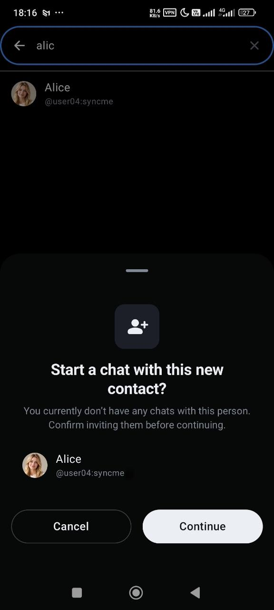<br /><sub>Confirm a new contact</sub></td>
    <td align="center" width="33%">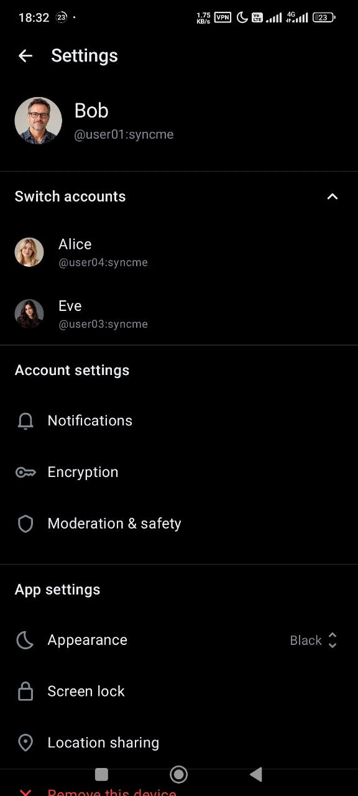<br /><sub>Settings and account switching</sub></td>
  </tr>
</table>

## What changed in SyncMe

**Conversation management.** Users can create, rename and assign up to three personal tags from the conversation list. Tag assignments and selected filters persist across launches. Removing a tag keeps its chats and history. The home list scrolls behind a floating new-chat button, with a narrow header fade and borderless filters in Light, Dark and Black themes. [Feature history](https://github.com/DrEsmaily/Syncme/blob/v1.5.3-build285/docs/syncme/cumulative-release-notes.md)

**Presence across screens.** Online, Away and last-seen indicators share the same observations across direct chats, profiles and the People screen. When only part of a group’s presence is known, its header displays an “at least” count. The service limits concurrent requests and reuses recent results as contacts scroll off screen and return. [Presence implementation](https://github.com/DrEsmaily/Syncme/blob/v1.5.3-build285/libraries/matrix/impl/src/main/kotlin/io/element/android/libraries/matrix/impl/user/RustPresenceService.kt)

**Read receipts and reactions.** Tapping an outgoing bubble opens *Seen by*, with each reader’s reactions next to their name. A later read position covers earlier messages in the same thread, while the avatar stays anchored to the latest read position. Automatic read acknowledgements follow the active chat and visible event. Tapping an attachment opens the media directly. [Message detail tests](https://github.com/DrEsmaily/Syncme/blob/v1.5.3-build285/features/messages/impl/src/test/kotlin/io/element/android/features/messages/impl/timeline/components/receipt/bottomsheet/MessageDetailsContentTest.kt) · [Media interaction tests](https://github.com/DrEsmaily/Syncme/blob/v1.5.3-build285/features/messages/impl/src/test/kotlin/io/element/android/features/messages/impl/timeline/components/TimelineMediaTapTest.kt)

**Media composition and delivery.** Users can select multiple photos and videos in order, add a shared caption and choose media quality or original files. Each upload reports the percentage and transferred bytes from the SDK send queue. Users can cancel a pending upload, and failed sends retain edited originals for retry. The album renderer sizes rows from image proportions so portrait screenshots stay readable alongside landscape photos. [Album rendering tests](https://github.com/DrEsmaily/Syncme/blob/v1.5.3-build285/features/messages/impl/src/test/kotlin/io/element/android/features/messages/impl/timeline/components/event/GalleryImageFitTest.kt)

**Conversation layout and bidirectional text.** Sender labels and media prefixes are laid out separately from captions so a Persian preview keeps its first word. Quoted text and its author follow the quote direction. Timestamps occupy a separate line below the message, including when the last line is a link. Sent and received messages use distinct surfaces in all three themes, with timestamps tested for at least 4.5:1 contrast across the six standard bubble colors. Reaction placement follows the sender’s side independently of text direction. [Bubble colors and contrast](https://github.com/DrEsmaily/Syncme/blob/v1.5.3-build285/features/messages/impl/src/test/kotlin/io/element/android/features/messages/impl/timeline/components/BubblePaletteTest.kt) · [Timestamp layout](https://github.com/DrEsmaily/Syncme/blob/v1.5.3-build285/features/messages/impl/src/test/kotlin/io/element/android/features/messages/impl/timeline/components/MessageTimestampFooterTest.kt) · [Reaction placement](https://github.com/DrEsmaily/Syncme/blob/v1.5.3-build285/features/messages/impl/src/test/kotlin/io/element/android/features/messages/impl/timeline/components/ReactionPlacementTest.kt)

**Settings, onboarding and group controls.** SyncMe has its own launcher artwork, welcome screen and login flow. The settings redesign gives menu rows consistent touch areas and keeps update status at the end of App settings. Group administrators have a confirmation step for closing a group, with member removal subject to Matrix permissions. [Design and group-management notes](https://github.com/DrEsmaily/Syncme/blob/v1.5.3-build285/docs/syncme/cumulative-release-notes.md)

**Updates from a self-hosted server.** The Android client checks for releases in the background. After an interrupted download it resumes from confirmed partial bytes, including after the app reopens. Before offering *Install* or *Later*, it validates the APK size, SHA-256 digest, package identity and signing certificate. The release workflow produces the matching APK and JSON manifest for hosting. [Hosting guide](https://github.com/DrEsmaily/Syncme/blob/v1.5.3-build285/docs/syncme/update-hosting.md)

**Reliability and diagnostics.** Work on identity-reset completion, FCM token handling and receipt retries is documented alongside the behaviors that still need device testing. Opt-in startup, TLS and decryption diagnostics use bounded capture so developers can investigate failures without leaving tracing enabled during ordinary use. [Technical review](https://github.com/DrEsmaily/Syncme/blob/v1.5.3-build285/docs/syncme/root-cause-review.md)

## Engineering decisions in the released code

| Problem | How SyncMe handles it | Code or tests |
| --- | --- | --- |
| An interrupted APK download can leave a partially written file. | The updater resumes from the last confirmed byte. If the server ignores the range request, it replaces the partial file. Before installation it checks the size, hash, package and signing certificate. | [Download recovery tests](https://github.com/DrEsmaily/Syncme/blob/v1.5.3-build285/features/preferences/impl/src/test/kotlin/io/element/android/features/preferences/impl/updates/ResumableUpdateDownloadTest.kt) |
| Fixed-size album tiles waste space around portrait photos or cut off their edges. | A Compose layout groups images into rows using their aspect ratios and the available chat width. Tests check that the image corners remain visible and that tapping a tile selects the right photo. | [Row layout tests](https://github.com/DrEsmaily/Syncme/blob/v1.5.3-build285/features/messages/impl/src/test/kotlin/io/element/android/features/messages/impl/timeline/components/event/GalleryRowsTest.kt) · [Rendering and tap tests](https://github.com/DrEsmaily/Syncme/blob/v1.5.3-build285/features/messages/impl/src/test/kotlin/io/element/android/features/messages/impl/timeline/components/event/GalleryImageFitTest.kt) |
| Opening a long conversation list can trigger repeated requests for the same person's presence. | SyncMe shares presence observations across screens, reuses fresh responses and bounds both concurrent requests and cached inactive users. | [Presence service](https://github.com/DrEsmaily/Syncme/blob/v1.5.3-build285/libraries/matrix/impl/src/main/kotlin/io/element/android/libraries/matrix/impl/user/RustPresenceService.kt) |

## Build and release

The project uses Kotlin, Jetpack Compose, Appyx and the Matrix Rust SDK. To inspect or build the version distributed above, start from the release tag. Use JDK 21 and install Android SDK Platform 37 and Build Tools 37.0.0 with Android Studio’s SDK Manager. See the [developer guide](https://github.com/DrEsmaily/Syncme/blob/v1.5.3-build285/docs/_developer_onboarding.md).

```sh
git clone --branch v1.5.3-build285 --depth 1 https://github.com/DrEsmaily/Syncme.git
cd Syncme
./gradlew :features:messages:impl:testDebugUnitTest --tests '*GalleryRowsTest'
```

To build a local debug APK, run `./gradlew :app:assembleGplayDebug`. Gradle writes the APKs to `app/build/outputs/apk/gplay/debug/`.

For changes to SyncMe itself, the [contribution guide](CONTRIBUTING.md) explains where to open a pull request and what to include for review.

The [release workflow](https://github.com/DrEsmaily/Syncme/blob/v1.5.3-build285/.github/workflows/syncme-bubble-colors-review.yml) runs the message regressions, assembles the optimized ARM64 APK and checks update compatibility. The [release page](https://github.com/DrEsmaily/Syncme/releases/tag/v1.5.3-build285) includes the APK, SHA-256 checksum and update manifest. Earlier versions are in [Releases](https://github.com/DrEsmaily/Syncme/releases). See the [self-hosted update guide](https://github.com/DrEsmaily/Syncme/blob/v1.5.3-build285/docs/syncme/update-hosting.md) for deployment and the [technical review](https://github.com/DrEsmaily/SyncMe/blob/syncme-cumulative-build-20261015/docs/syncme/root-cause-review.md) for known limits.

<details>
<summary>Build records and historical archives</summary>

This rolling list includes the current build and the nine preceding successful builds. Version 1.5.3 (Build 285) follows Version 1.5.2 (Build 284).

| Build | Verified execution | Downloads and documentation |
|---|---|---|
| 285 — Version 1.5.3 | [Run 43751178979](https://github.com/DrEsmaily/SyncMe/actions/runs/43751178979) | [APK](https://github.com/DrEsmaily/SyncMe/releases/download/v1.5.3-build285/SyncMe-285-ARM64.apk) · [Release notes](https://github.com/DrEsmaily/SyncMe/releases/tag/v1.5.3-build285) |
| 284 — Version 1.5.2 | [Run 43661375322](https://github.com/DrEsmaily/SyncMe/actions/runs/43661375322) | [APK](https://github.com/DrEsmaily/SyncMe/releases/download/v1.5.2-build284/SyncMe-284-ARM64.apk) · [Release notes](https://github.com/DrEsmaily/SyncMe/releases/tag/v1.5.2-build284) |
| 283 — Version 1.5.1 | [Run 43409344132](https://github.com/DrEsmaily/SyncMe/actions/runs/43409344132) | [APK](https://github.com/DrEsmaily/SyncMe/releases/download/v1.5.1-build283/SyncMe-283-ARM64.apk) · [Release notes](https://github.com/DrEsmaily/SyncMe/releases/tag/v1.5.1-build283) |
| 282 — Version 1.5.0 | [Run 42843781934](https://github.com/DrEsmaily/SyncMe/actions/runs/42843781934) | [APK](https://github.com/DrEsmaily/SyncMe/releases/download/v1.5.0-build282/SyncMe-282-ARM64.apk) · [Release notes](https://github.com/DrEsmaily/SyncMe/releases/tag/v1.5.0-build282) |
| 281 — Version 1.4.1 | [Run 42833442807](https://github.com/DrEsmaily/SyncMe/actions/runs/42833442807) | [APK](https://github.com/DrEsmaily/SyncMe/releases/download/v1.4.1-build281/SyncMe-281-ARM64.apk) · [Release notes](https://github.com/DrEsmaily/SyncMe/releases/tag/v1.4.1-build281) |
| 280 — Version 1.4.0 | [Run 42823717159](https://github.com/DrEsmaily/SyncMe/actions/runs/42823717159) | [APK](https://github.com/DrEsmaily/SyncMe/releases/download/v1.4.0-build280/SyncMe-280-ARM64.apk) · [Release notes](https://github.com/DrEsmaily/SyncMe/releases/tag/v1.4.0-build280) |
| 279 — Version 1.3.4 | [Run 42789085239](https://github.com/DrEsmaily/SyncMe/actions/runs/42789085239) | [APK](https://github.com/DrEsmaily/SyncMe/releases/download/v1.3.4-build279/SyncMe-279-ARM64.apk) · [Release notes](https://github.com/DrEsmaily/SyncMe/releases/tag/v1.3.4-build279) |
| 278 — Version 1.3.3 | [Run 42782954520](https://github.com/DrEsmaily/SyncMe/actions/runs/42782954520) | [APK](https://github.com/DrEsmaily/SyncMe/releases/download/v1.3.3-build278/SyncMe-278-ARM64.apk) · [Release notes](https://github.com/DrEsmaily/SyncMe/releases/tag/v1.3.3-build278) |
| 277 — Version 1.3.2 | [Run 42776171388](https://github.com/DrEsmaily/SyncMe/actions/runs/42776171388) | [APK](https://github.com/DrEsmaily/SyncMe/releases/download/v1.3.2-build277/SyncMe-277-ARM64.apk) · [Release notes](https://github.com/DrEsmaily/SyncMe/releases/tag/v1.3.2-build277) |
| 276 — Version 1.3.1 | [Run 42703777680](https://github.com/DrEsmaily/SyncMe/actions/runs/42703777680) | [APK](https://github.com/DrEsmaily/SyncMe/releases/download/v1.3.1-build276/SyncMe-276-ARM64.apk) · [Release notes](https://github.com/DrEsmaily/SyncMe/releases/tag/v1.3.1-build276) |

### Earlier preserved archive

[Version 1.3.0 · Build 275](https://github.com/DrEsmaily/SyncMe/releases/tag/v1.3.0-build275) remains available as a public release with its APK and documentation.

[Version 1.2.1 · Build 274](https://github.com/DrEsmaily/SyncMe/releases/tag/v1.2.1-build274) remains available as a public release with its APK and documentation.

[Version 1.2.0 · Build 273](https://github.com/DrEsmaily/SyncMe/releases/tag/v1.2.0-build273) remains available as a public release with its APK and documentation.

[Version 1.1.16 · Build 272](https://github.com/DrEsmaily/SyncMe/releases/tag/v1.1.16-build272) remains available as a public release with its APK and documentation.

[Version 1.1.15 · Build 271](https://github.com/DrEsmaily/SyncMe/releases/tag/v1.1.15-build271) remains available as a public release with its APK and documentation.

[Version 1.1.14 · Build 270](https://github.com/DrEsmaily/SyncMe/releases/tag/v1.1.14-build270) remains available as a public release with its APK and documentation.

[Version 1.1.13 · Build 269](https://github.com/DrEsmaily/SyncMe/releases/tag/v1.1.13-build269) remains available as a public release with its APK and documentation.

[Version 1.1.12 · Build 268](https://github.com/DrEsmaily/SyncMe/releases/tag/v1.1.12-build268) remains available as a public release with its APK and documentation.

[Version 1.1.11 · Build 267](https://github.com/DrEsmaily/SyncMe/releases/tag/v1.1.11-build267) remains available as a public release with its APK and documentation.

[Version 1.1.10 · Build 266](https://github.com/DrEsmaily/SyncMe/releases/tag/v1.1.10-build266) remains available as a public release with its APK and documentation.

[Version 1.1.9 · Build 265](https://github.com/DrEsmaily/SyncMe/releases/tag/v1.1.9-build265) remains available as a public release with its APK and documentation.

[Version 1.1.8 · Build 264](https://github.com/DrEsmaily/SyncMe/releases/tag/v1.1.8-build264) remains available as a public release with its APK and documentation.

[Version 1.1.7 · Build 263](https://github.com/DrEsmaily/SyncMe/releases/tag/v1.1.7-build263) remains available as a public release with its APK and documentation.

[Version 1.1.6 · Build 262](https://github.com/DrEsmaily/SyncMe/releases/tag/v1.1.6-build262) remains available as a public release with its APK and documentation.

[Version 1.1.5 · Build 261](https://github.com/DrEsmaily/SyncMe/releases/tag/v1.1.5-build261) remains available as a public release with its APK and documentation.

[Version 1.1.4 · Build 260](https://github.com/DrEsmaily/SyncMe/releases/tag/v1.1.4-build260) remains available as a public release with its APK and documentation.

[Version 1.1.3 · Build 259](https://github.com/DrEsmaily/SyncMe/releases/tag/v1.1.3-build259) remains available as a public release with its APK and documentation.

[Version 1.1.2 · Build 258](https://github.com/DrEsmaily/SyncMe/releases/tag/v1.1.2-build258) remains available as a public release with its APK and documentation.

[Build 257](https://github.com/DrEsmaily/SyncMe/actions/runs/39171234618/artifacts/12153525423) was distributed as a time-limited Actions artifact containing the APK and its build record.

[Version 1.1.1 · Build 256](https://github.com/DrEsmaily/SyncMe/releases/tag/v1.1.1-build256) remains available as a public release with its APK and documentation.

[Version 1.1.0 · Build 255](https://github.com/DrEsmaily/SyncMe/releases/tag/v1.1.0-build255) remains available as a public release with its APK and documentation.

[Version 1.0.0 · Build 254](https://github.com/DrEsmaily/SyncMe/releases/tag/v1.0.0-build254) remains available as a public release with its APK and documentation.

The original protected snapshot covers builds **244–253**. Builds [253](https://github.com/DrEsmaily/SyncMe/actions/runs/38658866967), [252](https://github.com/DrEsmaily/SyncMe/actions/runs/38633766604), [251](https://github.com/DrEsmaily/SyncMe/actions/runs/38586470729), [250](https://github.com/DrEsmaily/SyncMe/actions/runs/38547146922), [249](https://github.com/DrEsmaily/SyncMe/actions/runs/38513962735), [248](https://github.com/DrEsmaily/SyncMe/actions/runs/38400798130), [247](https://github.com/DrEsmaily/SyncMe/actions/runs/38362221920), [246](https://github.com/DrEsmaily/SyncMe/actions/runs/38345740737), [245](https://github.com/DrEsmaily/SyncMe/actions/runs/38314674913) and [244 (APK labelled 243)](https://github.com/DrEsmaily/SyncMe/actions/runs/38287593658) remain in the [protected-build archive](https://github.com/DrEsmaily/SyncMe/blob/syncme-cumulative-build-20261015/docs/syncme/history/protected-builds.json), alongside their historical notes. The rolling table above now includes builds 276 through 285; the archive records the earlier preservation operation.

[Historical build inventory](https://github.com/DrEsmaily/Syncme/blob/v1.5.3-build285/docs/syncme/history/runs.md)

</details>

## Copyright and License

**SyncMe Modifications & Additions:**
Copyright (c) 2026 DrEsmaily (SyncMe Project). SyncMe-specific modifications are licensed under AGPL-3.0-or-later.

**Upstream Base Project (Element X Android):**
Copyright (c) 2025 Element Creations Ltd.
Copyright (c) 2022 - 2025 New Vector Ltd.

### License Terms

**SyncMe** is free and open-source software distributed under the terms of the **GNU Affero General Public License v3.0 (AGPL-3.0)** (or, at your option, any later version), as published by the Free Software Foundation.

While the upstream `element-x-android` repository is dual-licensed by Element Creations Ltd under both the AGPL-3.0 and an Element Commercial License, this independent fork incorporates upstream code specifically under the terms of the **AGPL-3.0**. The combined fork is distributed under AGPL-3.0-or-later.

Original upstream attribution, commit history, and the `LICENSE` and `LICENSE-COMMERCIAL` files are preserved in the repository root for historical and legal compliance.

Unless required by applicable law or agreed to in writing, software distributed under the License is distributed on an "AS IS" BASIS, WITHOUT WARRANTIES OR CONDITIONS OF ANY KIND, either express or implied. See the [GNU Affero General Public License](LICENSE) for the specific language governing permissions and limitations.
