

# SyncMe for Android

**Version 1.1.14 · Build 270**

**SyncMe** is an independent Android Matrix messenger forked from [Element X Android](https://github.com/element-hq/element-x-android).
It adds a customized interface, personal conversation tags, shared presence indicators and optional diagnostic tools on top of the Matrix Rust SDK, Jetpack Compose and Appyx foundation.

This is the SyncMe development repository, not an official Element distribution.

## Latest release and downloads

**[Download SyncMe 1.1.14 · Build 270 — ARM64 APK](https://github.com/DrEsmaily/SyncMe/releases/download/v1.1.14-build270/SyncMe-270-ARM64.apk)**

- **Version 1.1.14 · Build 270 · Android 7.0+ · ARM64.** [Release notes](https://github.com/DrEsmaily/SyncMe/releases/tag/v1.1.14-build270) · [Verified build](https://github.com/DrEsmaily/SyncMe/actions/runs/40280144052) · [SHA-256](https://github.com/DrEsmaily/SyncMe/releases/download/v1.1.14-build270/SHA256.txt).
- Minor bugs fixed
- [Server upload files](https://github.com/DrEsmaily/SyncMe/releases/download/v1.1.14-build270/SyncMe-270-Server-Upload.zip) · [Update metadata](https://github.com/DrEsmaily/SyncMe/releases/download/v1.1.14-build270/latest.json) · [Hosting instructions](https://github.com/DrEsmaily/SyncMe/blob/build/syncme-270-settings-bounds/docs/syncme/update-hosting.md).
- [Source](https://github.com/DrEsmaily/SyncMe/tree/build/syncme-270-settings-bounds) · [Previous public release: 1.1.13 · Build 269](https://github.com/DrEsmaily/SyncMe/releases/download/v1.1.13-build269/SyncMe-269-ARM64.apk).

Download the APK directly without a GitHub account, then install it as an update over your existing SyncMe release. Actions artifacts are additional build records; the release APK does not expire with them.

## Features added or customized in SyncMe

These are recorded differences from the upstream version used as this fork's base. They are not claims of inventing these features across all messengers, or comparisons with every future Element release.

| Feature | Where it appears and what it does |
|---|---|
| **Online and Away presence** | Shared indicators on home DM avatars, chat headers, profiles and People; green Online and orange Away, based on actual Matrix responses. |
| **Last seen and group online counts** | English approximate last-seen labels and group counts qualified as “at least” when data is incomplete; unknown status is not guessed. |
| **Upload percentage and transferred size** | Real percentage, transferred/total bytes and a progress bar within conversations, driven by SDK send-queue state and fitted to the message bubble. |
| **Media-send controls** | Customized quality/original-file behavior, upload cancellation through message actions, and pending-upload presentation. |
| **Personal conversation tags** | Dedicated create, rename and management flows, conversation assignments and persistent home filters; up to three personal tags. |
| **In-app updates** | Final row under Settings → App settings, background version checks, resumable Android downloads and verified installation from the configured HTTPS update server. [Hosting instructions](https://github.com/DrEsmaily/SyncMe/blob/build/syncme-270-settings-bounds/docs/syncme/update-hosting.md). |
| **SyncMe identity and interface** | SM artwork, dedicated welcome screen, cobalt accents, black surfaces, simpler navigation, and customized menus, reactions and settings. |
| **Optional diagnostics** | Startup, TLS and decryption tools in Developer Options; default-off, bounded capture. |
| **Refined read-receipt behavior** | Reader avatars under the relevant outgoing message, retries after failure, and automatic receipts restricted to the active chat and visible event. |
| **Permission-based group closure** | A confirmed client-side management action; it does not erase every federated or device-local copy of history. |

### Inherited from Element X and Matrix

Matrix accounts/login, direct and group conversations, the end-to-end encryption foundation, message/media transport, synchronization and the receipt protocol come from the upstream platform. SyncMe adds or customizes the layers above rather than claiming the underlying messenger stack was built from scratch.

### Technical fixes and current limits

SyncMe includes identity-reset completion fixes, bounded FCM token handling, presence/receipt lifecycle corrections and regression coverage.
Current TLS verifies system trust, expiry/EKU and hostname, but omits online OCSP/CRL revocation checking; see the [technical review and limits](https://github.com/DrEsmaily/SyncMe/blob/syncme-cumulative-build-20261015/docs/syncme/root-cause-review.md).

Successful CI is separate from device verification. Large-file uploads under VPN, multi-device presence, background notifications and two-phone receipt behavior require runtime testing. Historical experiments on other branches are not automatically features of the current application.

## SyncMe screenshots

Explore SyncMe's welcome screen, conversation filters, presence indicators, personal tags and messaging interface.

<table>
  <tr>
    <td align="center" width="33%">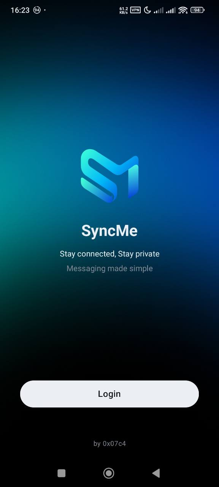 Welcome</td>
    <td align="center" width="33%">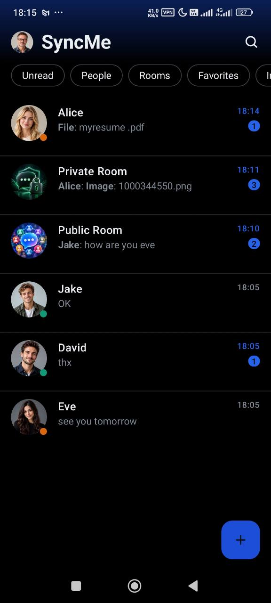 Online and Away presence</td>
    <td align="center" width="33%">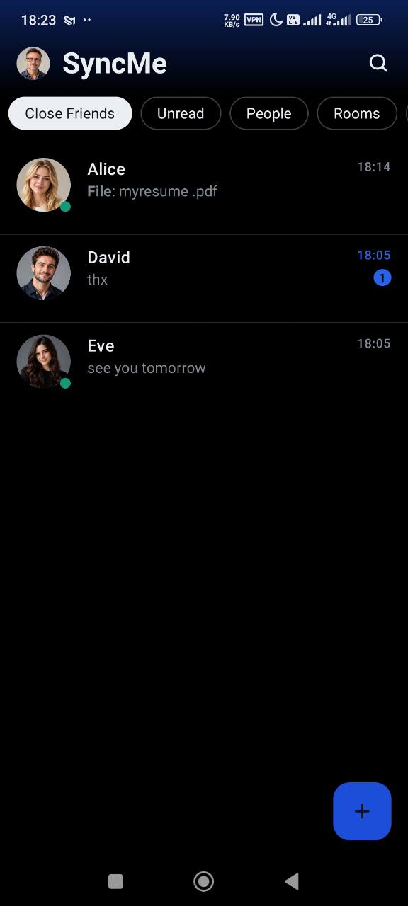 Personal tag filter</td>
  </tr>
  <tr>
    <td align="center" width="33%">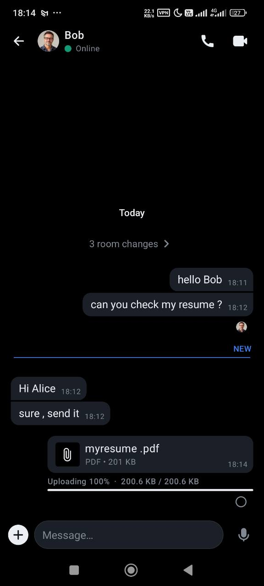 Upload percentage and size</td>
    <td align="center" width="33%">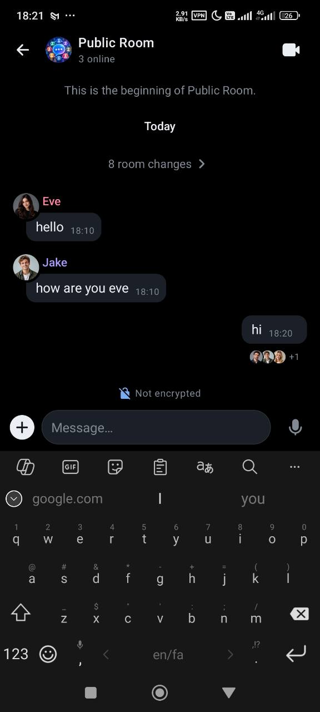 Group presence and reader avatars</td>
    <td align="center" width="33%">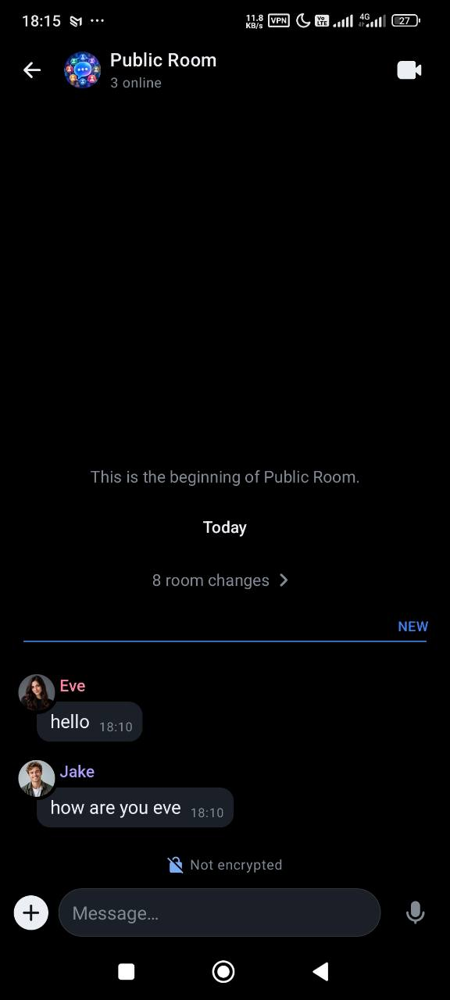 Unread message marker</td>
  </tr>
  <tr>
    <td align="center" width="33%">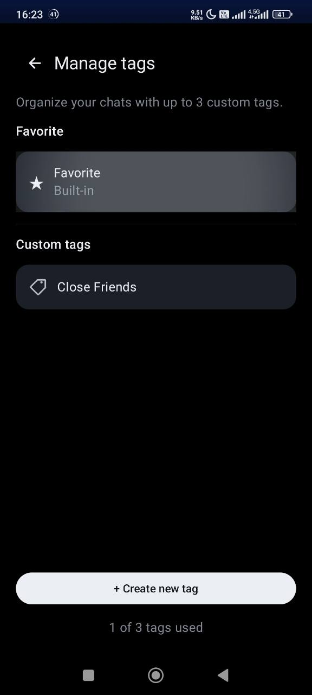 Manage personal tags</td>
    <td align="center" width="33%">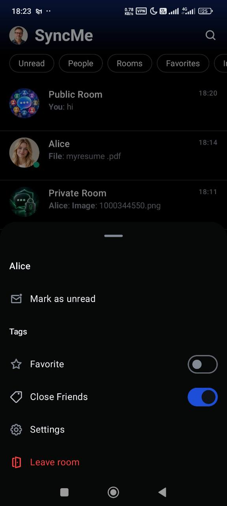 Conversation actions</td>
    <td align="center" width="33%">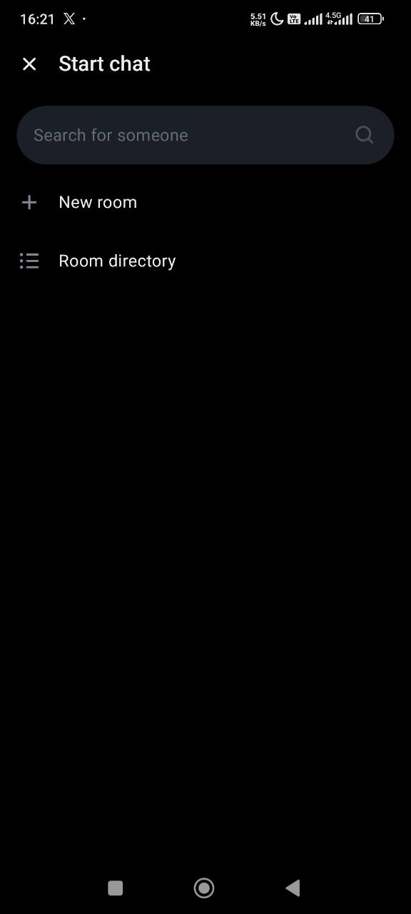 Start a chat</td>
  </tr>
  <tr>
    <td align="center" width="33%">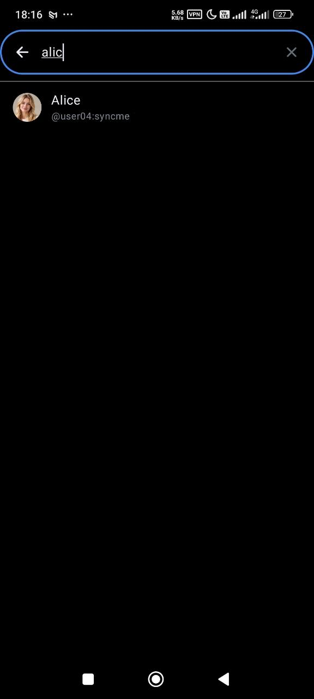 Search for people</td>
    <td align="center" width="33%">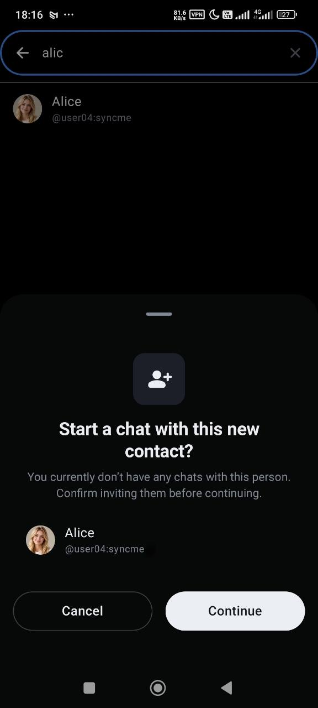 Confirm a new contact</td>
    <td align="center" width="33%">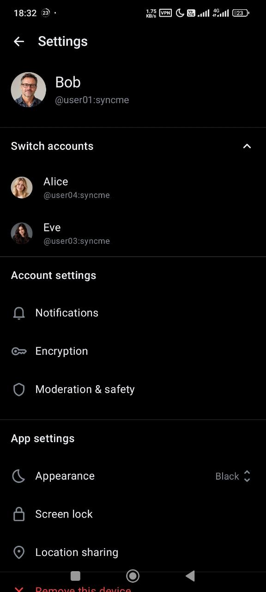 Settings and account switching</td>
  </tr>
</table>

## Latest 10 successful builds

This rolling list includes the current build and the nine preceding successful builds. Version 1.1.14 (Build 270) follows Version 1.1.13 (Build 269).

| Build | Verified execution | Downloads and documentation |
|---|---|---|
| 270 — Version 1.1.14 | [Run 40280144052](https://github.com/DrEsmaily/SyncMe/actions/runs/40280144052) | [APK](https://github.com/DrEsmaily/SyncMe/releases/download/v1.1.14-build270/SyncMe-270-ARM64.apk) · [Release notes](https://github.com/DrEsmaily/SyncMe/releases/tag/v1.1.14-build270) |
| 269 — Version 1.1.13 | [Run 40259329512](https://github.com/DrEsmaily/SyncMe/actions/runs/40259329512) | [APK](https://github.com/DrEsmaily/SyncMe/releases/download/v1.1.13-build269/SyncMe-269-ARM64.apk) · [Release notes](https://github.com/DrEsmaily/SyncMe/releases/tag/v1.1.13-build269) |
| 268 — Version 1.1.12 | [Run 40256575761](https://github.com/DrEsmaily/SyncMe/actions/runs/40256575761) | [APK](https://github.com/DrEsmaily/SyncMe/releases/download/v1.1.12-build268/SyncMe-268-ARM64.apk) · [Release notes](https://github.com/DrEsmaily/SyncMe/releases/tag/v1.1.12-build268) |
| 267 — Version 1.1.11 | [Run 40163722101](https://github.com/DrEsmaily/SyncMe/actions/runs/40163722101) | [APK](https://github.com/DrEsmaily/SyncMe/releases/download/v1.1.11-build267/SyncMe-267-ARM64.apk) · [Release notes](https://github.com/DrEsmaily/SyncMe/releases/tag/v1.1.11-build267) |
| 266 — Version 1.1.10 | [Run 40162426521](https://github.com/DrEsmaily/SyncMe/actions/runs/40162426521) | [APK](https://github.com/DrEsmaily/SyncMe/releases/download/v1.1.10-build266/SyncMe-266-ARM64.apk) · [Release notes](https://github.com/DrEsmaily/SyncMe/releases/tag/v1.1.10-build266) |
| 265 — Version 1.1.9 | [Run 40153566396](https://github.com/DrEsmaily/SyncMe/actions/runs/40153566396) | [APK](https://github.com/DrEsmaily/SyncMe/releases/download/v1.1.9-build265/SyncMe-265-ARM64.apk) · [Release notes](https://github.com/DrEsmaily/SyncMe/releases/tag/v1.1.9-build265) |
| 264 — Version 1.1.8 | [Run 40150641003](https://github.com/DrEsmaily/SyncMe/actions/runs/40150641003) | [APK](https://github.com/DrEsmaily/SyncMe/releases/download/v1.1.8-build264/SyncMe-264-ARM64.apk) · [Release notes](https://github.com/DrEsmaily/SyncMe/releases/tag/v1.1.8-build264) |
| 263 — Version 1.1.7 | [Run 40148224229](https://github.com/DrEsmaily/SyncMe/actions/runs/40148224229) | [APK](https://github.com/DrEsmaily/SyncMe/releases/download/v1.1.7-build263/SyncMe-263-ARM64.apk) · [Release notes](https://github.com/DrEsmaily/SyncMe/releases/tag/v1.1.7-build263) |
| 262 — Version 1.1.6 | [Run 40146274001](https://github.com/DrEsmaily/SyncMe/actions/runs/40146274001) | [APK](https://github.com/DrEsmaily/SyncMe/releases/download/v1.1.6-build262/SyncMe-262-ARM64.apk) · [Release notes](https://github.com/DrEsmaily/SyncMe/releases/tag/v1.1.6-build262) |
| 261 — Version 1.1.5 | [Run 40131437006](https://github.com/DrEsmaily/SyncMe/actions/runs/40131437006) | [APK](https://github.com/DrEsmaily/SyncMe/releases/download/v1.1.5-build261/SyncMe-261-ARM64.apk) · [Release notes](https://github.com/DrEsmaily/SyncMe/releases/tag/v1.1.5-build261) |

### Earlier preserved archive

[Version 1.1.4 · Build 260](https://github.com/DrEsmaily/SyncMe/releases/tag/v1.1.4-build260) remains available as a public release with its APK and documentation.

[Version 1.1.3 · Build 259](https://github.com/DrEsmaily/SyncMe/releases/tag/v1.1.3-build259) remains available as a public release with its APK and documentation.

[Version 1.1.2 · Build 258](https://github.com/DrEsmaily/SyncMe/releases/tag/v1.1.2-build258) remains available as a public release with its APK and documentation.

[Build 257](https://github.com/DrEsmaily/SyncMe/actions/runs/39171234618/artifacts/12153525423) remains preserved as an Actions artifact with its APK and provenance.

[Version 1.1.1 · Build 256](https://github.com/DrEsmaily/SyncMe/releases/tag/v1.1.1-build256) remains available as a public release with its APK and documentation.

[Version 1.1.0 · Build 255](https://github.com/DrEsmaily/SyncMe/releases/tag/v1.1.0-build255) remains available as a public release with its APK and documentation.

[Version 1.0.0 · Build 254](https://github.com/DrEsmaily/SyncMe/releases/tag/v1.0.0-build254) remains available as a public release with its APK and documentation.

The original protected snapshot covers builds **244–253**. Builds [253](https://github.com/DrEsmaily/SyncMe/actions/runs/38658866967), [252](https://github.com/DrEsmaily/SyncMe/actions/runs/38633766604), [251](https://github.com/DrEsmaily/SyncMe/actions/runs/38586470729), [250](https://github.com/DrEsmaily/SyncMe/actions/runs/38547146922), [249](https://github.com/DrEsmaily/SyncMe/actions/runs/38513962735), [248](https://github.com/DrEsmaily/SyncMe/actions/runs/38400798130), [247](https://github.com/DrEsmaily/SyncMe/actions/runs/38362221920), [246](https://github.com/DrEsmaily/SyncMe/actions/runs/38345740737), [245](https://github.com/DrEsmaily/SyncMe/actions/runs/38314674913) and [244 (APK labelled 243)](https://github.com/DrEsmaily/SyncMe/actions/runs/38287593658) remain in the [protected-build archive](https://github.com/DrEsmaily/SyncMe/blob/syncme-cumulative-build-20261015/docs/syncme/history/protected-builds.json), alongside their historical notes. The rolling table above now includes 258 through 267; the archive records the earlier preservation operation.

[Historical cleanup report and preservation record](https://github.com/DrEsmaily/SyncMe/blob/syncme-cumulative-build-20261015/docs/syncme/cleanup-proposal.md)

## Development and preserved history

The latest verified application source is on [`build/syncme-270-settings-bounds`](https://github.com/DrEsmaily/SyncMe/tree/build/syncme-270-settings-bounds). Version 1.1.14 (Build 270) builds on the verified Build 269 source; [release notes](https://github.com/DrEsmaily/SyncMe/releases/tag/v1.1.14-build270).
Start with the cumulative notes, presence review and root-cause review. The rebuild branch's `docs/syncme/history` records the initial 422 Actions executions, 797 commits across build lineages, distinct historical note revisions and a separate cumulative history for each protected build.

Older descriptions can record superseded behavior or unfinished work. Always check their date, exact commit and newer evidence. Actions cleanup does not remove Git history. The original ten-build preservation snapshot remains documented separately from the rolling latest-build list above. The public releases for Builds 254, 255, 256, 258, 259, 260, 261, 262, 263, 264, 265, 266, 267, 268, 269 and 270 provide persistent APK downloads.

## Building and contributing

Release identity follows [Semantic Versioning and separate build identifiers](https://github.com/DrEsmaily/SyncMe/blob/build/syncme-270-settings-bounds/docs/syncme/versioning.md), using `syncme-release.properties` as the canonical source.

The application requires Android 7.0+ (API 24). Development uses JDK 21 and the Android toolchain. See [contributing](CONTRIBUTING.md) and [developer onboarding](docs/_developer_onboarding.md).

The dedicated SyncMe workflow runs regressions, builds `:app:assembleGplayRelease`, retains the existing `.syncmerelease` application identity, checks ARM64/version/manifest/JNI metadata and bundles cumulative documentation and checksums.
Report SyncMe-specific issues in [this repository](https://github.com/DrEsmaily/SyncMe/issues).

## Upstream attribution

SyncMe is derived from [element-hq/element-x-android](https://github.com/element-hq/element-x-android). Original history, attribution and the [LICENSE](LICENSE) and [LICENSE-COMMERCIAL](LICENSE-COMMERCIAL) files are preserved. SyncMe branding does not change those license terms.

## Copyright and License

**SyncMe Modifications & Additions:**
Copyright (c) 2026 DrEsmaily (SyncMe Project). SyncMe-specific modifications are licensed under AGPL-3.0-or-later.

**Upstream Base Project (Element X Android):**
Copyright (c) 2025 Element Creations Ltd.
Copyright (c) 2022 - 2025 New Vector Ltd.

### License Terms

**SyncMe** is free and open-source software distributed under the terms of the **GNU Affero General Public License v3.0 (AGPL-3.0)** (or, at your option, any later version), as published by the Free Software Foundation.

While the upstream `element-x-android` repository is dual-licensed by Element Creations Ltd under both the AGPL-3.0 and an Element Commercial License, this independent fork incorporates upstream code specifically under the terms of the **AGPL-3.0**. The combined fork is distributed under AGPL-3.0-or-later. 

Original upstream attribution, commit history, and the `LICENSE` and `LICENSE-COMMERCIAL` files are preserved in the repository root for historical and legal compliance.

Unless required by applicable law or agreed to in writing, software distributed under the License is distributed on an "AS IS" BASIS, WITHOUT WARRANTIES OR CONDITIONS OF ANY KIND, either express or implied. See the [GNU Affero General Public License](LICENSE) for the specific language governing permissions and limitations.
